# REPORT A2: Stamp Stories site redesign (2026-10-11)

Cloud session https://claude.ai/code/session_01KfyVy8vTsPb1ps8kaj9XgK, started Sun 2026-10-11 2:53 PM ET from `main` at
`d855e01`. Branch `site-design-2026-10`. **Not pushed: GitHub refused the push (HTTP 403), so this branch is delivered as
a git bundle** (STEP 6 bundle route; see the end of this report). Nothing was merged and no repo or Pages setting was touched.

## 1. Plan and what the review changed
Full plan: `results/DESIGN_PLAN_A2.md`. The first-pass plan (Inter everywhere, gradient hero with a button, rounded
shadowed cards, lavender + gold) matched what I produce for any shop site, so the review replaced nearly all of it:
- **Hero = a pane of stamps.** A royal-purple sheet margin holds perforated tiles, one per category with its count, and
  a "27 more categories" tile. It is the shop's most characteristic object (178 of 421 listings are sheets/panes) and it
  is the browsing menu. The side margin carries "Mail early in the day", the one quiet selvage joke.
- **Type:** League Gothic (self-hosted woff2, 10,444 bytes, OFL) for headlines, the condensed gothic of stamp
  inscriptions, which also fits 80-character titles; body in the visitor's Charter serif stack (0 bytes).
- **Materials:** light theme = album page with a faint quadrille grid; dark theme = stockbook black with glassine
  strips; purple bands = selvage; cancel red = keyboard focus and the "Has a story" mark.
- **Perforation is the one bold device**, used only on the hero pane, the featured stamps and the item-page stamp. No
  shadows, gradients or hover animations; rows are plain album rows.
- **Template chrome removed:** no middle-dot meta strings, no arrows on links, no all-caps labels.
- **Critique pass with screenshots ("remove one accessory"):** removed the rule above each decade group (rows, the
  grid and the gutter heading already group them); completed the hero pane to 3x3 on wide screens instead of leaving
  holes; let the hero headline run on one line on wide screens; the 9th tile spans the row on phones; softened title underlines in long
  lists. The decade heuristic was also fixed after the first screenshots showed "Civil War 1861" (a 2011 sheet) under
  1860s: it now uses the first year a title mentions and skips runs of catalog numbers. Each decade section says
  "Grouped by the first year each title mentions."

## 2. What was built (all in `build.py`, `assets/`, `tools/`, `tests/`, `data/stories.csv`)
- Home: selvage header, pane hero, search (plain JS: AND-match on words, live count in an `aria-live` region, `?q=` in
  the URL so it survives Back and reloads, an empty state with "Clear the search" and a store link), a featured row of 6
  perforated stamps (storied listings, one per category in turn, biggest category first), then sections by category.
  Sections with 30+ listings (Sheets, Revenues, 1901-40: Unused, Postal History) get decade sub-headings from a year in
  the title; the rest go under "Year not in the title". Identical titles (3 groups, 8 listings today) appear once with
  "Separate listings: Listing 1, Listing 2, ..." links; nothing says they are the same item.
- Item page: breadcrumb; the title printed as the stamp's design inside a perforated, framed stamp (photo layout swaps
  in the image and moves the title below it); Category / Format ("Buy It Now", "Auction") / Condition when present;
  story or blurb; one dominant "See it on eBay" button; store link; 3-6 related titles from the same category (fewer
  only when the category has fewer other titles).
- Photos: `data/images.csv` (`item,image_url`, https only) turns on the photo stamp, 64 px home thumbnails, photo
  featured stamps, `og:image`, JSON-LD `image` and feed enclosures. Tested with a 2-row fixture.
- SEO/sharing: unique `<title>` and description on every page (duplicate titles get "(listing 2 of 4)"), canonical,
  `og:title/description/url/type/site_name/image`, Twitter `summary_large_image`. `og:image` = listing photo, else
  `assets/og-stamp-stories.png` (1200x630, 27,375 bytes, rendered once in this session from `tools/og_image_source.html`,
  never at build time). JSON-LD: `WebSite` (with a SearchAction on `?q=`) + `Organization` on home; `BreadcrumbList` +
  `Product` (name, url, category, description, brand StampedeUSA, image if any) on items, **no offers, no price**.
  `sitemap.xml` has `lastmod` (the build date, UTC). `feed.xml` stays RSS 2.0 (adds atom self link, lastBuildDate,
  category, channel image). 404 page is `noindex`. Favicon is a small perforated SVG.
- Workflow: only `"assets/**"` was added to the push paths in `.github/workflows/pages.yml`.
- Untouched: `data/listings.csv`, `data/blurbs.csv`, `.claude/`, `tools/make_blurbs.py`, `tests/test_build.py`.

## 3. Before / after screenshots
Home shots are the top 3,200 px of the page. Before = `main` at `d855e01`; after = this branch, served over HTTP.

| Page | Before | After |
|---|---|---|
| home 390px light | 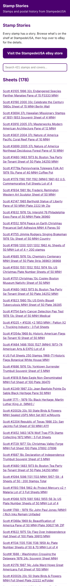 | 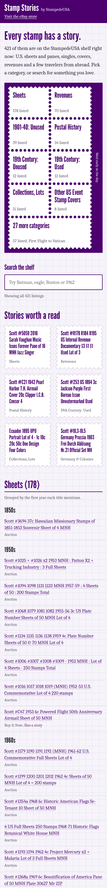 |
| home 390px dark | 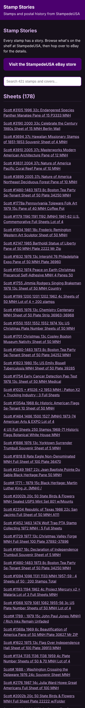 | 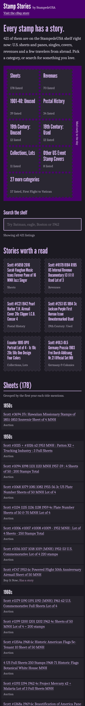 |
| home 1280px light | 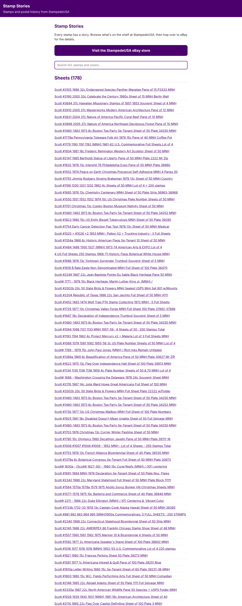 | 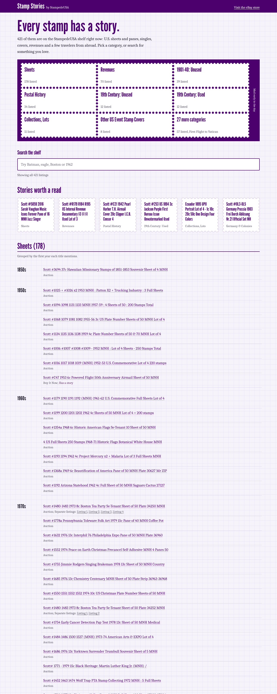 |
| home 1280px dark | 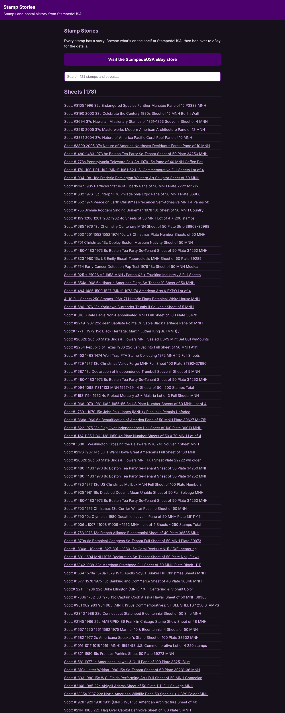 | 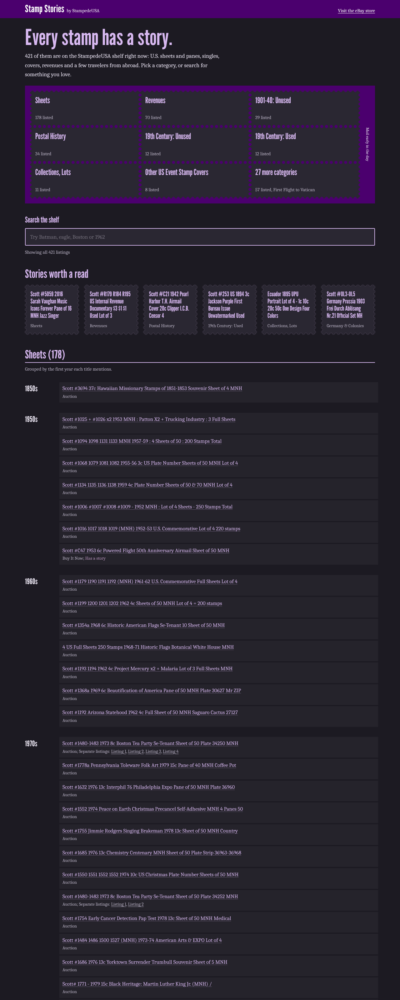 |
| item 390px light | 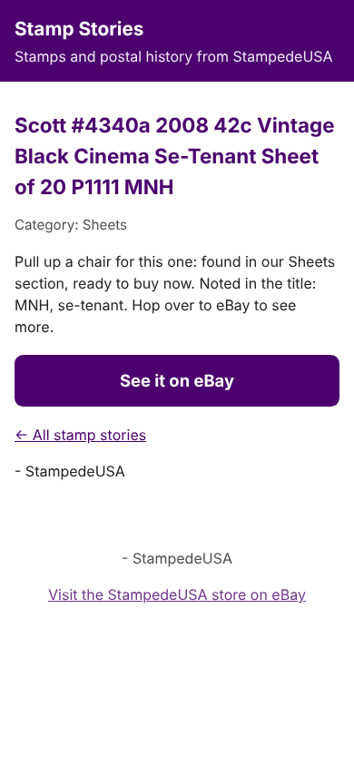 | 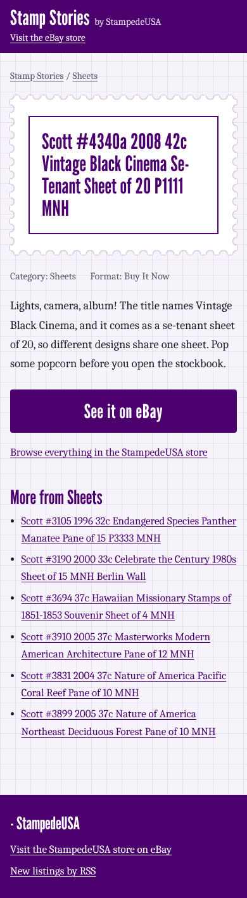 |
| item 390px dark | 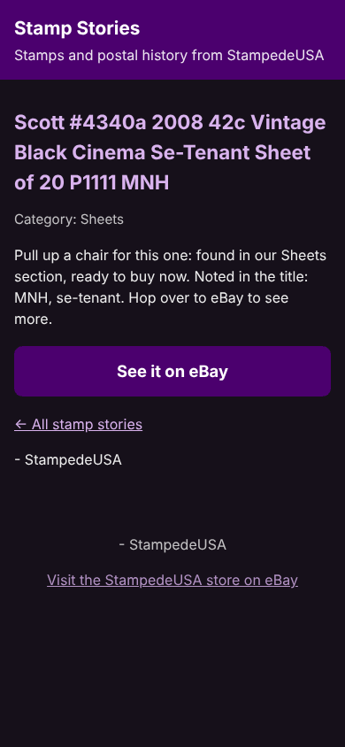 | 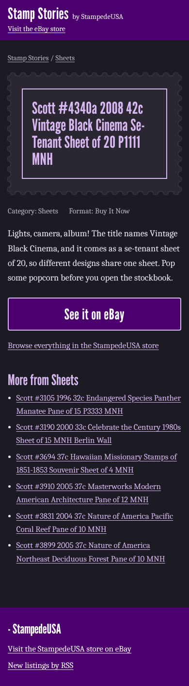 |
| item 1280px light | 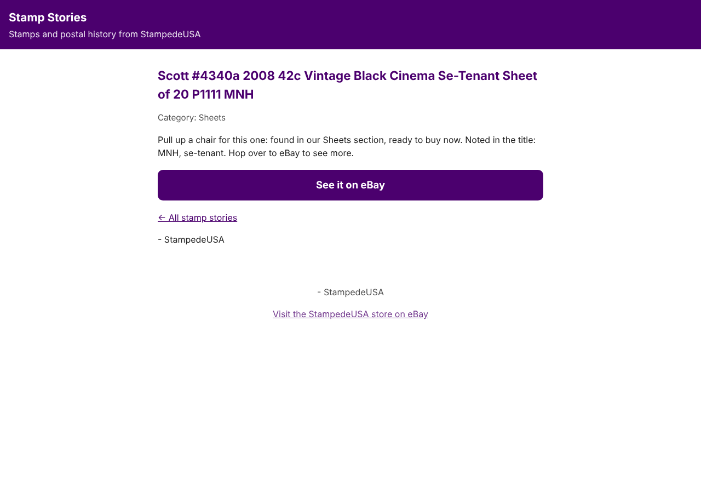 | 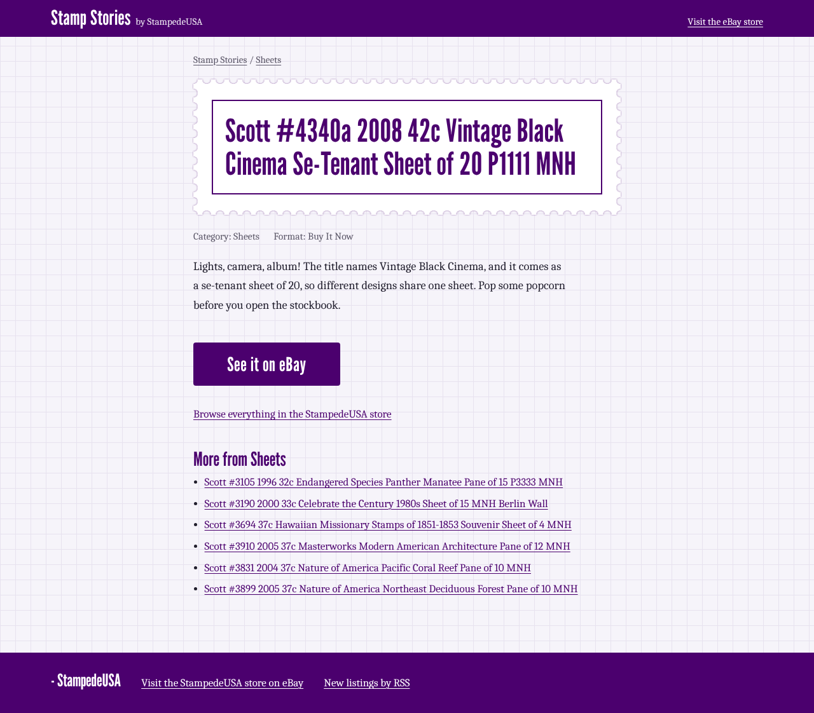 |
| item 1280px dark | 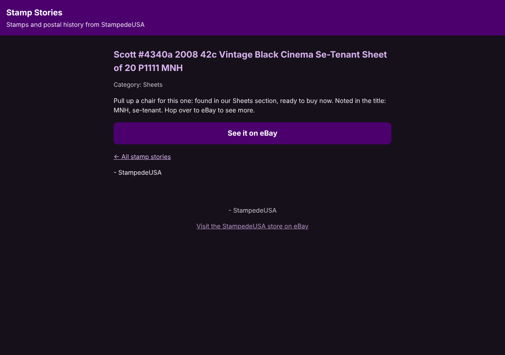 | 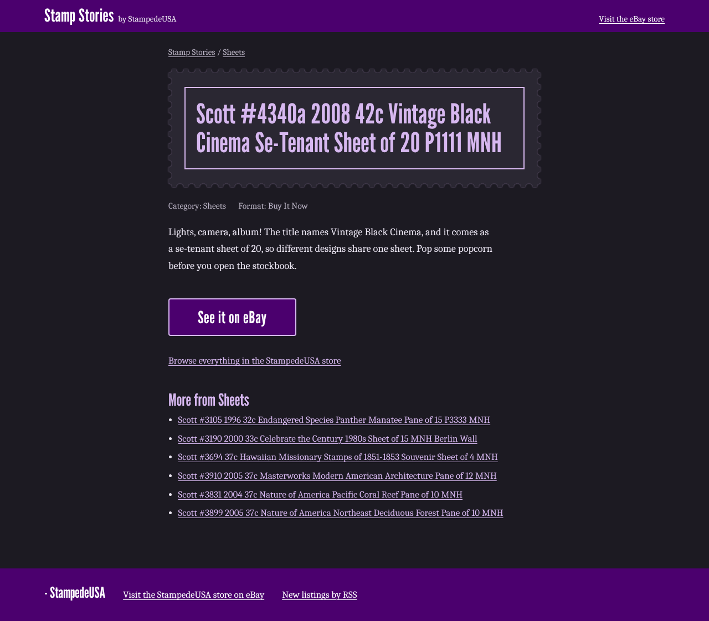 |

## 4. Tests and checks
`python3 -m unittest discover -s tests`: 12 tests on `main` as received (OK); now:
```
Ran 28 tests in 1.623s
OK
```
16 new tests in `tests/test_site_a2.py`: share tags on every page, unique titles/descriptions, JSON-LD parses with no
offers/price keys, no `$`+digit / "price" / "deal" outside titles (pages, feed, CSS), RSS and sitemap parse with lastmod,
every internal link and anchor resolves, item page parts and related links, self-hosted assets and 1200x630 PNG, search
markup, images fixture, story kept / dropped on retitle / ended item ignored, NO SOURCE has no source line, a story with
a stray `$` stops the build, identical titles, decade groups, the year heuristic.

Build into a temp dir with the current listings (`tools/verify.py` in the session scratchpad):
```
rows 421 item pages 421 MATCH
internal links checked 6551 broken 0
feed.xml parses as XML, root rss
sitemap.xml parses as XML, root {http://www.sitemaps.org/schemas/sitemap/0.9}urlset
JSON-LD blocks 844 failures/price keys 0
price pattern hits outside titles 0
home html bytes 145047 | largest item page 168267327950.html 5496 | css bytes 8815 | font bytes 10444 | og png bytes 27375
```
Browser checks (Playwright + Chromium, served over local HTTP at `/stampede-stories/`, 390 px):
```
initial: Showing all 421 listings
batman: 1 listing matches | url index.html?q=batman | featured hidden true
  visible: [
  'Scott #4084 2006 39c DC Comics Super Heroes Pane 20 Batman Selvage Tear MNH'
]
boston tea: 6 listings match
zzqx: 0 listings match | empty shown true | Nothing on the shelf matches "zzqx" yet.Try one word, a Scott number like 3099, or a year. Clear the search to see everything, or browse the whole StampedeUSA store on eBay.
after clear: Showing all 421 listings | focus on q q
opened: item/167532712112.html
after Back: q= dinosaurs | count 1 listing matches | before 1 listing matches
?q=sesame load: sesame | 1 listing matches
first tab: Skip to the stamps
tile link -> cat-revenues
item btn href: https://www.ebay.com/itm/167532712128 | related count 6
related -> 167532712123.html
crumb -> index.html#cat-sheets
btn focus outline: solid rgb(179, 38, 30) 3px
font loaded: true
page errors: none
```

## 5. Sizes and contrast
| Measure | Before | After |
|---|---|---|
| Home page HTML | 57,536 bytes | 145,047 bytes (decade groups, `data-s` search text per row, featured row) |
| Largest item page | n/a | 5,496 bytes (`168267327950.html`); item 167532711458: 2,722 -> 5,433 bytes |
| Stylesheet | inline in every page | `assets/site.css` 8,815 bytes, cached once |
| Font bytes | 0 | 10,444 (one woff2) |

Contrast ratios (WCAG 2.x formula, computed from the hex values):
```
15.16:1  LIGHT body text: postmark ink on album page  (#1F1D2B on #F6F4FA)
13.02:1  LIGHT body text on quadrille grid line  (#1F1D2B on #E7E2EF)
12.62:1  LIGHT links/headlines: royal purple on album page  (#4B006E on #F6F4FA)
13.78:1  LIGHT tile names: royal purple on stamp paper  (#4B006E on #FFFFFF)
 6.45:1  LIGHT small text (--soft) on album page  (#5B566A on #F6F4FA)
 7.04:1  LIGHT small text (--soft) on stamp paper  (#5B566A on #FFFFFF)
 5.99:1  LIGHT 'Has a story' cancel red on album page  (#B3261E on #F6F4FA)
 5.99:1  LIGHT focus ring cancel red vs album page  (#B3261E on #F6F4FA)
13.78:1  Selvage text: white on royal purple  (#FFFFFF on #4B006E)
13.78:1  Button text: white on royal purple  (#FFFFFF on #4B006E)
14.26:1  DARK body text on stockbook  (#ECE8F3 on #1C1A22)
12.69:1  DARK body text on glassine strip  (#ECE8F3 on #26242c)
 9.84:1  DARK links/headlines: lilac on stockbook  (#D7B8F0 on #1C1A22)
 8.37:1  DARK tile names: lilac on dark stamp paper  (#D7B8F0 on #2A2732)
 7.47:1  DARK small text (--soft) on glassine strip  (#B9B2C6 on #26242c)
 7.54:1  DARK 'Has a story' / focus ring #FF8A80 on stockbook  (#FF8A80 on #1C1A22)
 9.84:1  DARK lilac button border vs stockbook  (#D7B8F0 on #1C1A22)
13.78:1  Search box border royal purple vs stamp paper (non-text, 3:1)  (#4B006E on #FFFFFF)
```

## 6. Stories (STEP 4)
50 stories written for the first 50 data rows at `d855e01` in `data/stories.csv`; review table with every factual
claim on its own line in `results/STORIES_REVIEW_A2.md`. **Sourced: 0. NO SOURCE: 50.** No reference site was
reachable from this cloud environment (curl to postalmuseum.si.edu, britannica.com, loc.gov, nps.gov, en.wikipedia.org:
no connection; three research helpers hit the same block on every host). So, as STEP 4 directs, every story is warm and
claim-free: it restates only what the title, category and format say. All 50 are live in this build (titles unchanged).

## 7. Skipped or not done, and why
- **Push and PR:** `git push` to `StampedeStamps/stampede-stories` returned HTTP 403 (the session git proxy has no
  credential for that repo; attaching it with push access was refused by the session's permission check). Bundle route used.
- **Sourced history in stories:** network policy blocks the reference sites (above).
- **UNVERIFIED:** how Google's Rich Results Test treats a `Product` with no `offers` (it may call it ineligible for
  product rich results; the brief forbids offers). Not tested against Facebook's or Pinterest's share debuggers (no
  access). `og:type` is `website` on every page because `product` invites price fields.
- `data/blurbs.csv` (the review snapshot) was not regenerated; the site does not read it.

## 8. What happened, in order
1. Found the task file was not in `stampede-cloud-work` (this session's repo); found it in the public
   `stampede-stories` repo and cloned that read-only.
2. STEP 0: 421 rows, header correct, 12 tests passed on `main`; Playwright + Chromium already installed; before
   screenshots taken; push refused with 403, noted in `results/START_A2_2026-10-11.md`.
3. STEP 1: wrote the design plan, reviewed it against the brief, replaced the generic parts.
4. STEP 2-3: rebuilt `build.py` and added `assets/` (CSS, font + OFL, favicon, share image), search, decade groups,
   identical-title handling, photo layout, share tags, JSON-LD, sitemap lastmod.
5. STEP 4: tried to source 50 stories; every reference site was blocked; wrote 50 claim-free NO SOURCE stories and the
   claims review.
6. STEP 5: 28 tests pass; 421 pages, 0 broken links, XML and JSON-LD clean, 0 price hits; took screenshots, critiqued,
   removed one accessory and fixed the decade grouping, re-shot.
7. STEP 6: wrote this report, committed, made the bundle `results/site-design-2026-10.bundle`.

## 9. For OMEN: fetch, test, open the PR
```
git fetch <path-to>/site-design-2026-10.bundle site-design-2026-10:site-design-2026-10
git checkout site-design-2026-10 && python -m unittest discover -s tests
git push -u origin site-design-2026-10   # then open a PR to main; never merge without review
```
